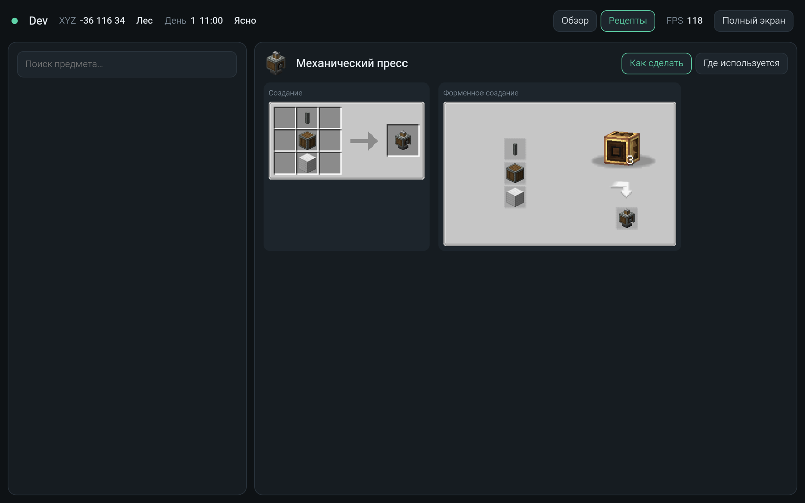
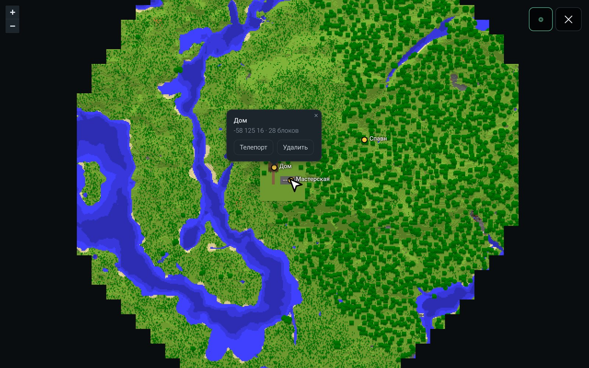
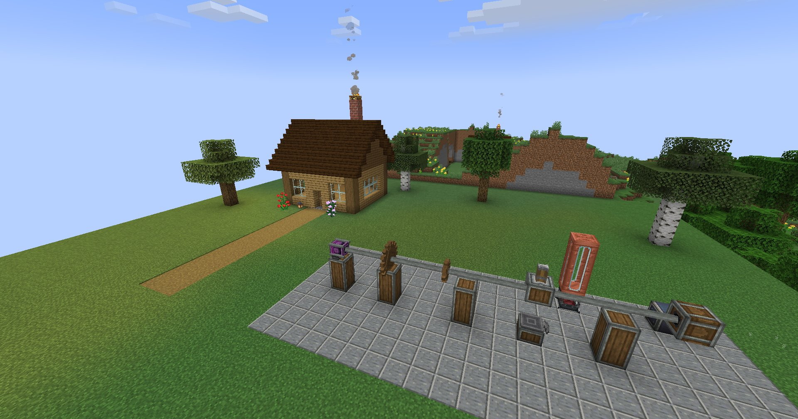

# SideDash

A second-screen dashboard for games. Open it in your tablet's browser and see your inventory, stats, map and recipes while you play. Inspired by sim-racing dashboards, but for non-racing games.

First game: **Minecraft 1.21.1 (NeoForge)**, built for Create.


| Recipes (JEI) | World map with waypoints |
|---|---|
|  |  |



## What's on the tablet

- **Vitals**: health with absorption, hunger, saturation, armor, air, XP. Active effects with timers.
- **Inventory**: real item icons (same render as in game), durability, enchant glow. Tap an item to see its full tooltip. Double-tap a hotbar slot to select it in game.
- **World map**: every chunk you explore is saved, like a world-map mod. Pan with a finger, pinch to zoom smoothly, fullscreen. Tap to add a waypoint or teleport there. Teleport is a normal `/tp` command, so it needs cheats or op.
- **Looking at**: the block or mob under your crosshair. For Create blocks (and any addon that supports engineer's goggles) it shows the goggle info: speed, stress, fluids and so on.
- **Recipes (JEI)**: search any item, then see "how to make" and "used in". Recipes are drawn by JEI itself, so every Create and addon recipe type is supported.
- The UI follows the game's language (Russian or English).

## How to use

1. Install the mod (or the modpack below) and start a world.
2. Chat shows a link like `http://192.168.1.5:25580/k3x9ab/`. Open it on a tablet or phone on the **same Wi-Fi**. You can also show the link again with `/sidedash`.
3. Tip: add the page to the home screen and turn off auto-lock while playing.

The random part of the URL is a key, so other devices on the network can't read your game. Port and key live in `config/sidedash.properties`.

The mod is **client-only**. It works in singleplayer and on any server (it only reads what your own client sees).

## Modpack (CurseForge)

`modpack/` builds a CurseForge import zip: Create 6, about 20 popular Create addons, JEI, Jade, Xaero's Minimap and World Map, plus Sodium, ModernFix and FerriteCore for performance.

```
python modpack/resolve.py            # pick latest 1.21.1 NeoForge versions + dependencies -> manifest.json
./gradlew build
python modpack/pack.py               # -> modpack/SideDash-Create-Pack-<ver>.zip
```

In CurseForge: **Create Custom Profile → Import** and select the zip. Pre-built zips are on the Releases page.

Left out on purpose:

- Create Aeronautics and Create Stuff 'N Additions: their CurseForge ids can't be resolved automatically yet.
- Bits 'n' Bobs: it refuses to load next to TFMG 1.2.0.

## Development

- JDK 21. `./gradlew runClient` starts a dev client; put test mods in `run/mods`.
- `./gradlew runClient -PquickWorld=<save folder>` loads a world directly.
- Code map:
  - `WebServer`: tiny HTTP server, java.base only. Live data goes over Server-Sent Events.
  - `GameData`: all game reads, always run on the client thread.
  - `Render`: offscreen render to PNG, used for icons and recipes.
  - `SideDashJei`: optional JEI bridge.
  - Dashboard page: `src/main/resources/web/index.html`.

## Roadmap

- More games: Baldur's Gate 3 (journal and inventory through Script Extender), Green Hell (stats through a BepInEx mod).
- A desktop hub, once a second game exists.
